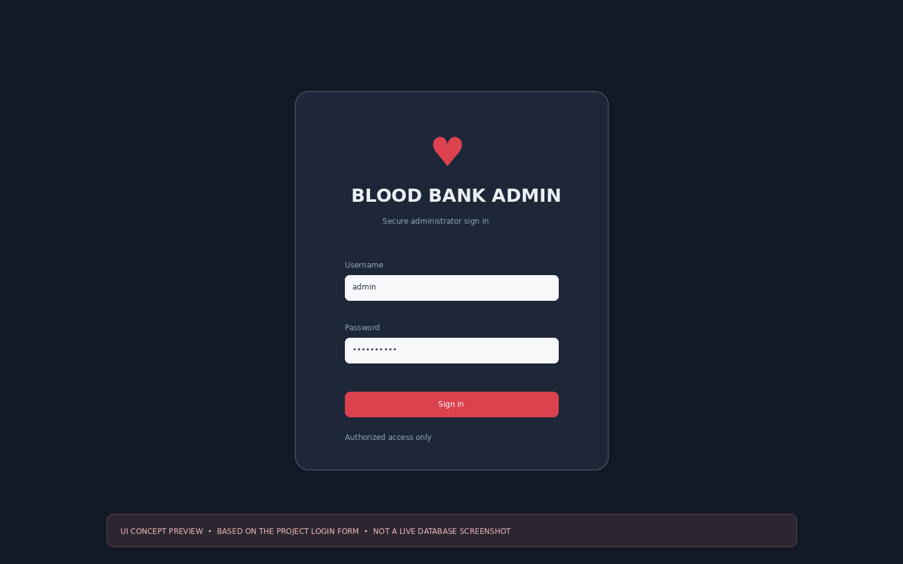
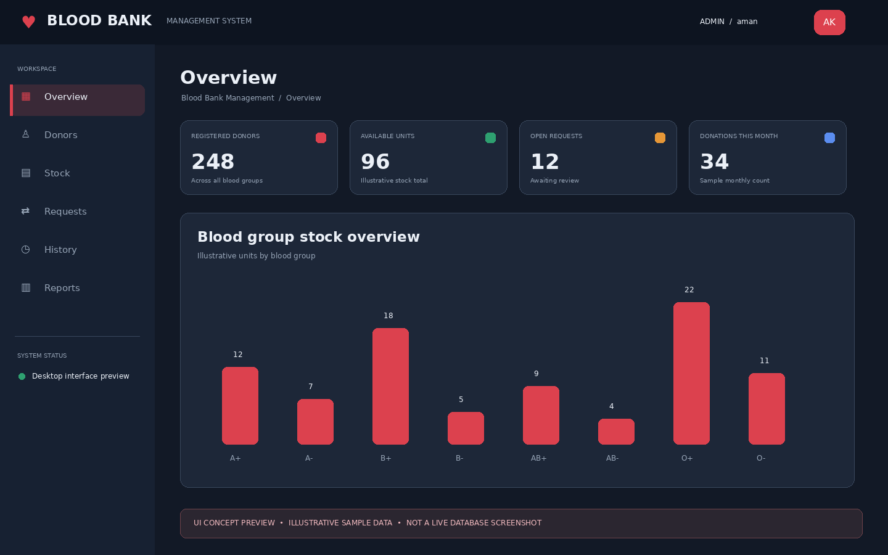
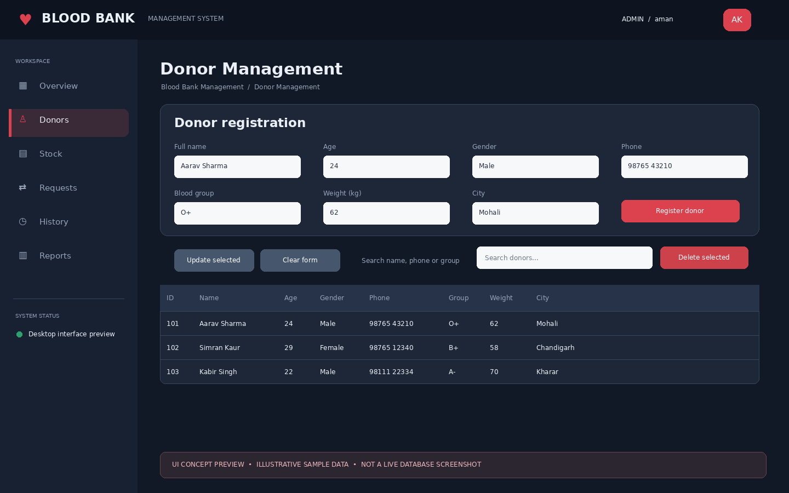
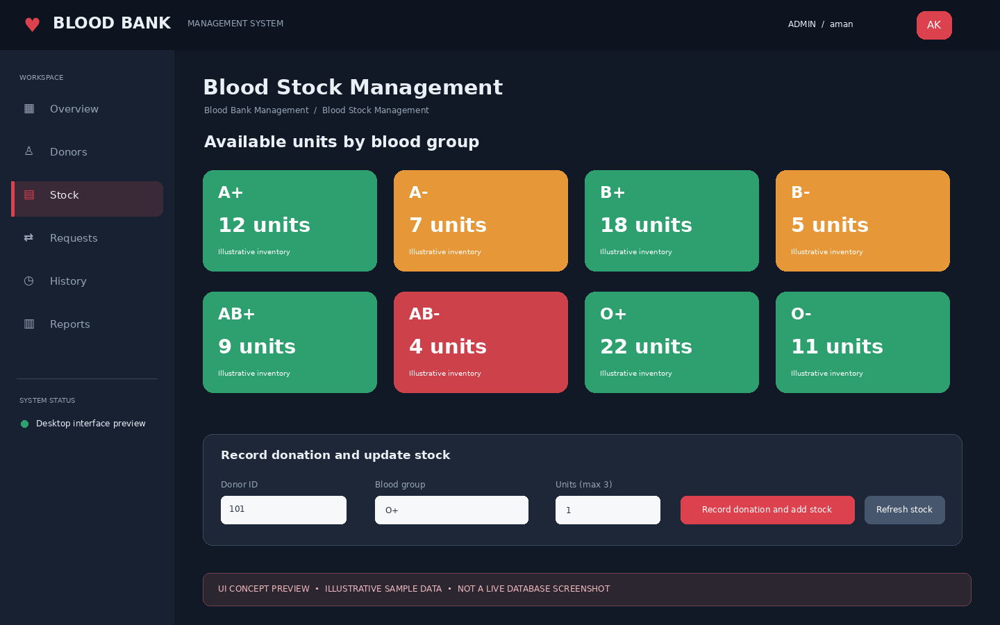
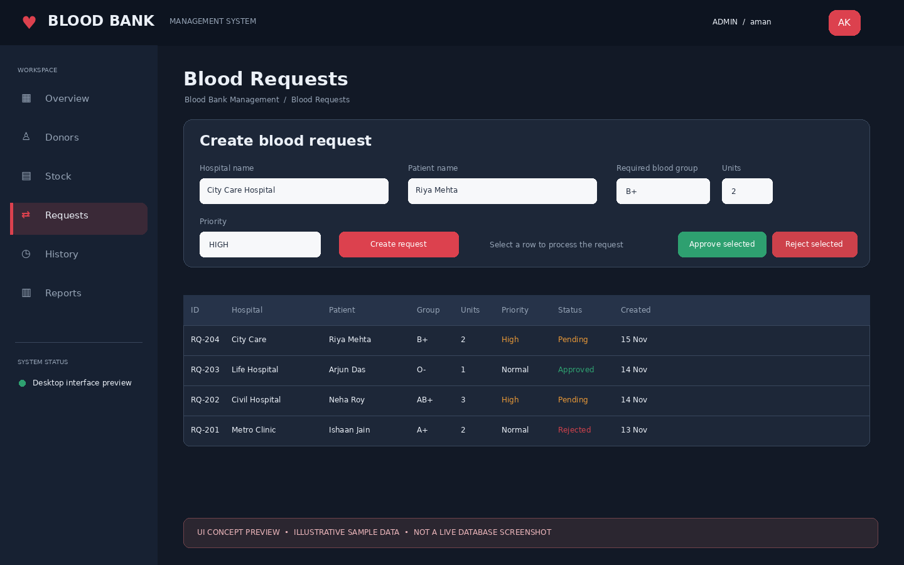
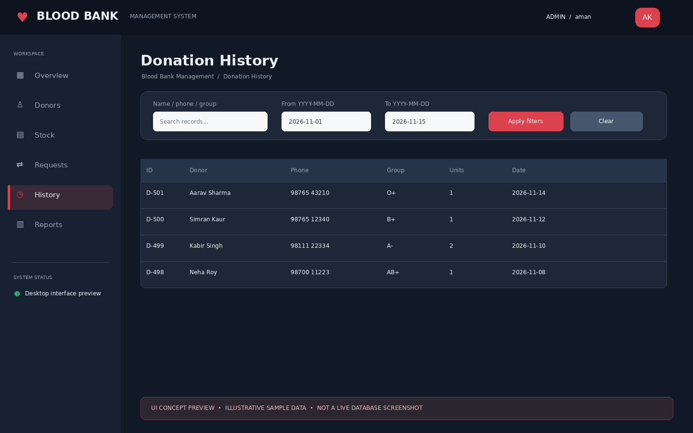
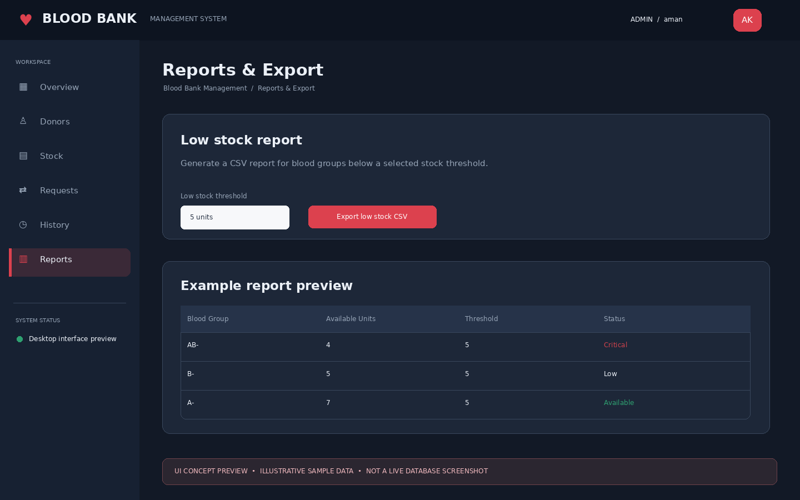

# 🩸 Blood Bank Management System

A Java-based desktop application designed to manage blood donors, blood inventory, hospital blood requests, donation history, and stock reports.

Built using Java Swing, JDBC, MySQL, and Maven.

## 🚀 Features

- Admin Login System
- Donor Registration and Management
- Donor Search and Validation
- Blood Group Inventory Management
- Blood Request Management
- Blood Compatibility Checking
- Request Approval and Rejection
- Donation History Tracking
- Low Stock Alerts
- Stock Reports and CSV Export
- Java2D Stock Visualization
- Background Stock Expiry Monitoring

## 💻 Technology Stack

| Technology | Usage |
|---|---|
| Java 17 | Backend Development |
| Java Swing | GUI Development |
| JDBC | Database Connectivity |
| MySQL 8 | Database |
| Maven | Build Management |
| Java2D | Data Visualization |

## 📸 Application Screenshots

### 1. Admin Login


### 2. Dashboard Overview


### 3. Donor Management


### 4. Blood Stock Management


### 5. Blood Requests


### 6. Donation History


### 7. Reports & Export


## 📂 Project Structure

```text
BloodBankManagementSystem/
│
├── src/main/java/bloodbank/
│   ├── core/
│   ├── db/
│   ├── exception/
│   ├── service/
│   ├── thread/
│   ├── ui/
│   └── util/
│
├── src/main/resources/
│   └── db.properties.example
│
├── schema.sql
├── sample_data.sql
├── pom.xml
├── README.md
└── VIVA_NOTES.md
```

## ⚙️ Requirements

- JDK 17 or later
- Apache Maven 3.8+
- MySQL 8
- Visual Studio Code or IntelliJ IDEA

## 🗄️ Database Configuration

1. Install and configure MySQL.
2. Import `schema.sql`.
3. Import `sample_data.sql` (optional).
4. Copy `db.properties.example` to `db.properties`.
5. Configure your local database credentials.

Never upload your actual database password to GitHub.

## ▶️ Build and Run

From the project root directory:

```bash
mvn clean compile
```

To launch the application:

```bash
mvn exec:java
```

A running MySQL server and valid database configuration are required to use the application.

## 👨‍💻 Team Members

- Aman Kumar
- Sarika
- Tanya
- Manraj

## 🔮 Future Improvements

- Role-Based Authentication
- Donor Appointment Scheduling
- Email and SMS Notifications
- Advanced Blood Inventory Management
- Audit Logging
- Automated Testing

## ⚠️ Disclaimer

This project is developed for academic and educational purposes. Blood compatibility rules are simplified for demonstration and must not be used for actual clinical transfusion decisions.

---

⭐ If you find this project interesting, consider giving the repository a star!